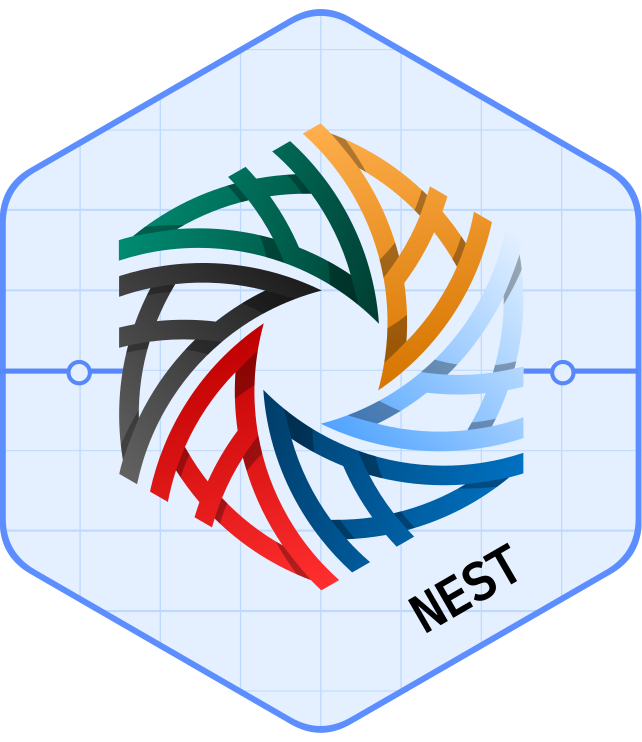

::::: {.about-hero}
:::: {.about-hero-copy}
# About NEST

Who we are, and why we build NEST in the open.
::::

::: {.about-art-wrap}
{.about-art}

{.about-hex-logo fig-alt="NEST hex sticker"}
:::
:::::

:::::: {.about-history}
::::: {.about-history-lead}
::: {.about-eyebrow}
Our story
:::

## A shared effort for faster, more consistent clinical reporting {.unnumbered}

:::: {.about-mission-card}
::: {.about-mission-text}
### Our mission {.unnumbered}

Provide high-quality tools that make clinical analysis and reporting more efficient, reproducible, and accessible.
:::
::::
:::::

::::: {.about-history-copy}
NEST began as an internal project at Roche, started by a small team of data scientists who wanted clinical reporting to be faster and more consistent.

We soon saw strong interest from others facing the same problems, which is why we opened it up, and why we now build it alongside collaborators through efforts such as pharmaverse.

Our reason is simple: better tools, shared widely, help bring new medicines to patients sooner. R is free, and we build with it every day, so we give back to the community that makes it possible. Working in the open also lets us be clearer about how results are computed, build shared standards and validation approaches, and give teams the flexibility to adapt the tools to their needs.
:::::
::::::

::::: {.about-story}
:::: {.about-pair}
::: {.about-row .about-row-community}
{.about-hex fig-alt="pharmaverse hex sticker"}

::: {.about-row-text}
### Our community {.unnumbered}

Many NEST packages now live in [pharmaverse](https://pharmaverse.org){target="_blank" rel="noopener"}, where we work with other pharma and biotech companies to build, improve, and adopt open-source tools for clinical reporting together.
:::
:::

::: {.about-row .about-row-impact}
::: {.about-row-text}
### Our impact {.unnumbered}

Our regulatory reporting packages are validated for regulatory use at Roche and supported Roche's first R-based submission to the FDA. Interactive tools like teal help teams explore and review the data along the way.
:::
:::
::::
:::::


