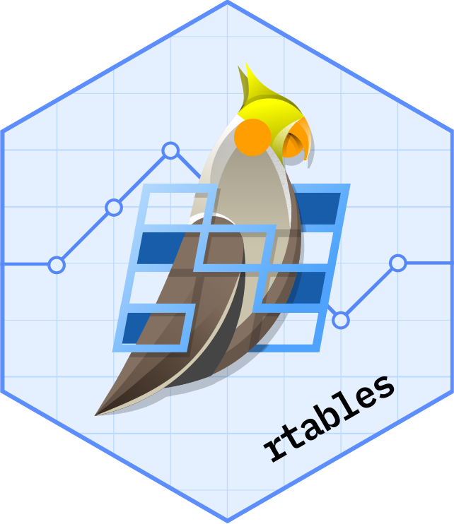
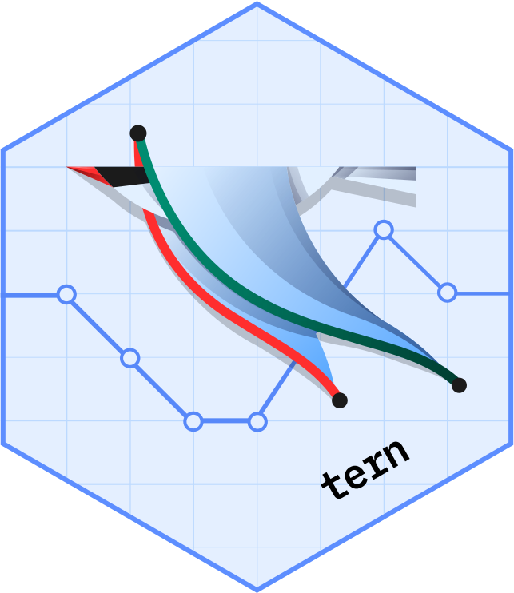
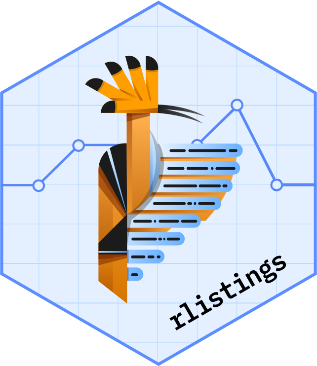
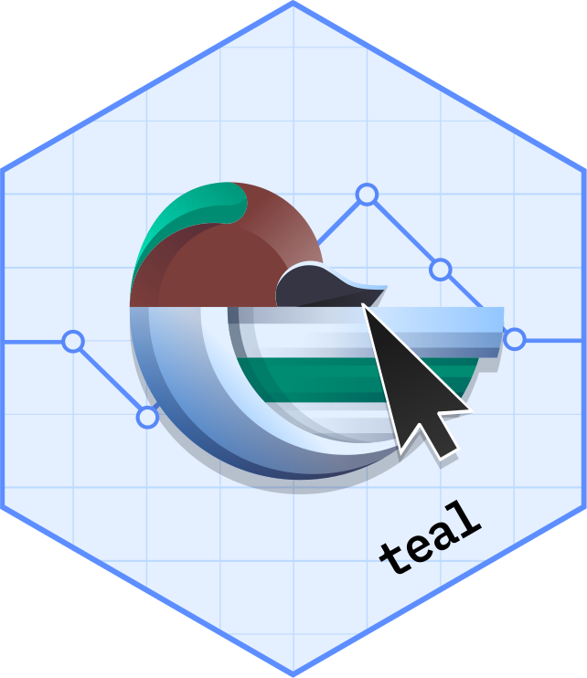
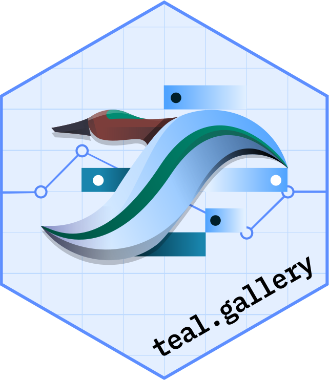
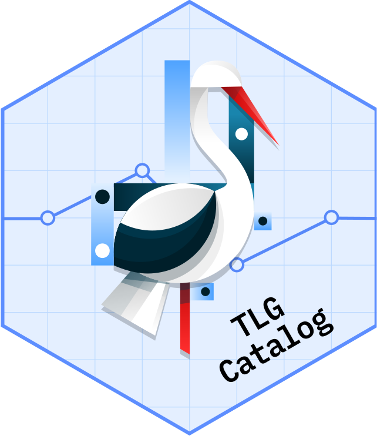
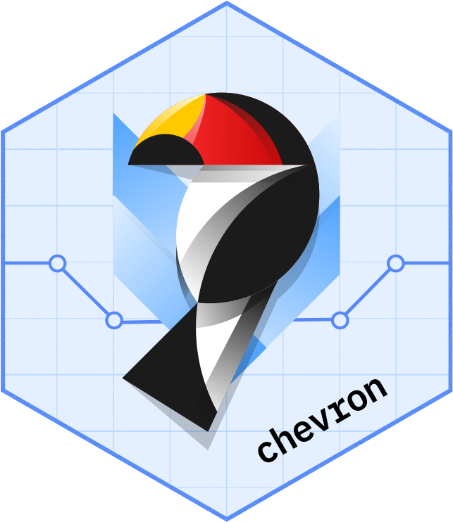
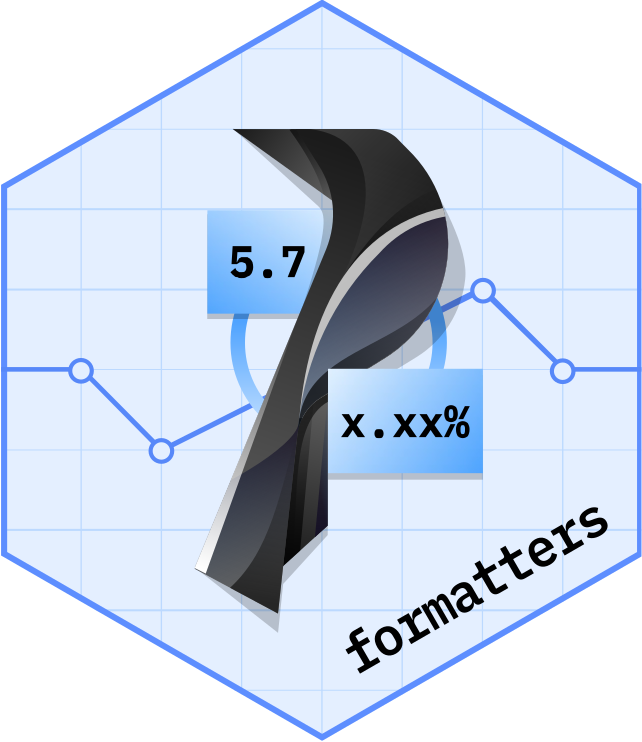
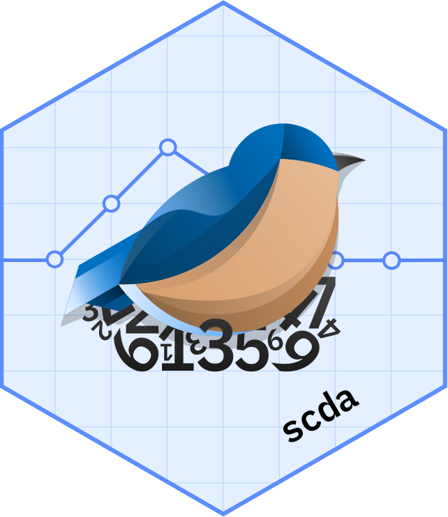
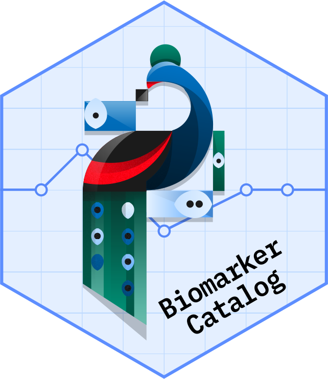

::: {.grid}

::: {.g-col-6}

:::

::: {.g-col-6}
**NEST** is a collection of open-sourced R packages, which enables faster and more efficient insights generation under clinical research settings, for both exploratory and regulatory purposes. It provides solutions for creating tables, listing, graphs, and interactive dashboards for clinical study reporting as well as data exploration.

 

NEST was originally developed at Roche. Since open-sourced, it has attracted many collaborators through efforts such as pharmaverse. With the vision of accelerating clinical reporting, we welcome new collaborators from academia, pharmaceutical industry, and clinical research institutes.
:::

:::

 

## Packages

Click on the hex logo to learn more out some key packages under the NEST project

<!-- Using raw HTML code + CSS to build the hexwall -->

  

    
    
    
  

  

    
    
    
    
  

  

    
    
    
  

 

## History

<TODO> add a timeline here