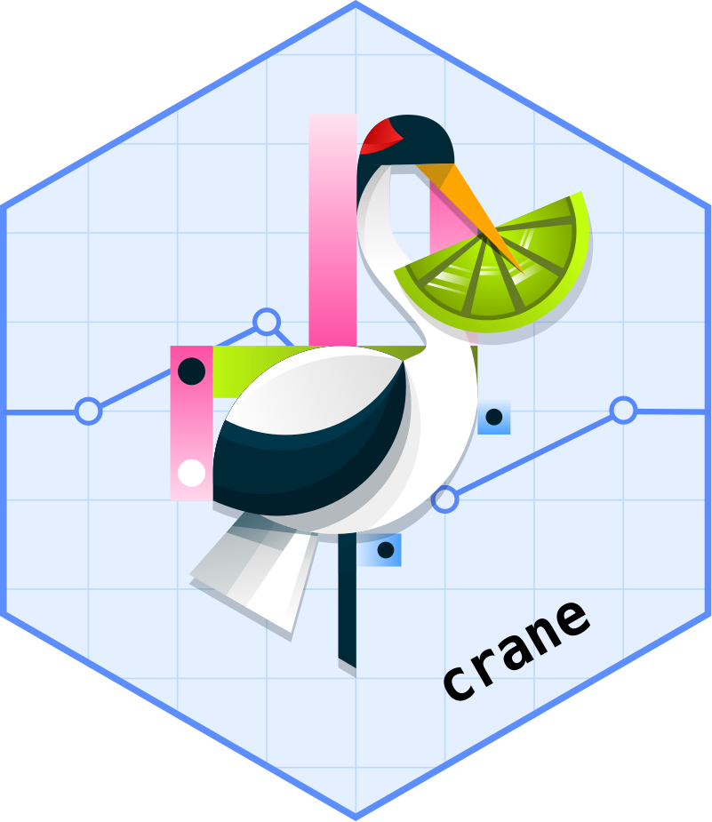
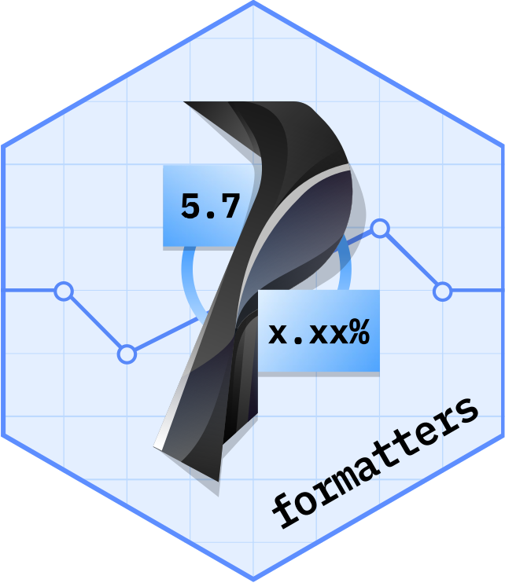

::::: {.hero}
:::: {.hero-copy}
::: {.eyebrow}
Open-source clinical reporting
:::

# [[Better tools.]{.t}]{.line} [[Clearer insights.]{.t .sweep}]{.line .accent}

Turn clinical data into meaningful results. Discover R packages built for analysis, reporting, and exploration.

::: {.actions}
[Explore the tools [→]{.arrow}](products.qmd){.btn-nest}
:::

::: {.tagline}
Built in the open. Shaped by the community.
:::

::: {.scroll-cue}
[[]{.bi .bi-chevron-down}](#latest-from-nest){aria-label="Scroll to the latest news"}
:::
::::
:::::

::::: {.news-band}
::: {.band-head}
::: {}
::: {.eyebrow}
Keep up with the ecosystem
:::
## Latest from NEST
:::
::: {.more}
[All news →](news.qmd)
:::
:::

::: {#latest-news}
:::
:::::

::::: {.products-band}
::: {.band-head}
::: {}
::: {.eyebrow}
Small tools. Shared possibilities.
:::
## Find your starting point
:::
::: {.more}
[See all products →](products.qmd)
:::
:::

```{=html}
<div class="pc" role="region" aria-label="NEST products">
<button class="pc-btn pc-prev" type="button" aria-label="Previous product"><span class="bi bi-chevron-left"></span></button>
<div class="pc-track" tabindex="0">
<div class="card-tool">
<div class="head"><div><div class="name">teal</div><div class="kind">Interactive exploration</div></div></div>
<div class="desc">Bring your data into interactive applications for exploration and review.</div>
<a class="go" href="https://pharmaverse.github.io/teal/" target="_blank" rel="noopener">Explore teal ↗</a>
</div>
<div class="card-tool">
<div class="head"><div><div class="name">cards</div><div class="kind">Analysis results</div></div></div>
<div class="desc">A foundation for working with structured analysis results in R.</div>
<a class="go" href="https://pharmaverse.github.io/cards/" target="_blank" rel="noopener">Explore cards ↗</a>
</div>
<div class="card-tool">
<div class="head"><div><div class="name">cardx</div><div class="kind">Extended analysis</div></div></div>
<div class="desc">Extend your analysis workflows with additional tools for results.</div>
<a class="go" href="https://pharmaverse.github.io/cardx/" target="_blank" rel="noopener">Explore cardx ↗</a>
</div>
<div class="card-tool">
<div class="head"><div><div class="name">crane</div><div class="kind">Lorem ipsum</div></div></div>
<div class="desc">Lorem ipsum dolor sit amet, consectetur adipiscing elit, sed do eiusmod tempor.</div>
<a class="go" href="https://pharmaverse.github.io/crane/" target="_blank" rel="noopener">Explore crane ↗</a>
</div>
<div class="card-tool">
<div class="head"><div><div class="name">formatters</div><div class="kind">Lorem ipsum</div></div></div>
<div class="desc">Lorem ipsum dolor sit amet, consectetur adipiscing elit, sed do eiusmod tempor.</div>
<a class="go" href="https://pharmaverse.github.io/formatters/" target="_blank" rel="noopener">Explore formatters ↗</a>
</div>
</div>
<button class="pc-btn pc-next" type="button" aria-label="Next product"><span class="bi bi-chevron-right"></span></button>
</div>
<script>
// Move the product row by exactly one card per click; the browser handles scrolling and snapping.
(function () {
  var track = document.querySelector('.pc-track');
  if (!track) return;
  var prev = document.querySelector('.pc-prev'), next = document.querySelector('.pc-next');
  var reduce = window.matchMedia('(prefers-reduced-motion: reduce)').matches;
  function step() {
    var card = track.querySelector('.card-tool');
    return card.getBoundingClientRect().width + (parseFloat(getComputedStyle(track).columnGap) || 0);
  }
  function update() {
    prev.disabled = track.scrollLeft <= 2;
    next.disabled = track.scrollLeft + track.clientWidth >= track.scrollWidth - 2;
  }
  function move(dir) {
    track.scrollBy({ left: dir * step(), behavior: reduce ? 'auto' : 'smooth' });
    setTimeout(update, 450); setTimeout(update, 900); // refresh the arrows once the scroll has settled
  }
  prev.addEventListener('click', function () { move(-1); });
  next.addEventListener('click', function () { move(1); });
  track.addEventListener('scroll', update, { passive: true });
  track.addEventListener('scrollend', update);
  window.addEventListener('resize', update);
  update();
})();
</script>
```
:::::

::::: {.community-band}
::: {}
### Built together. Shared openly.

Explore the code, ask a question, or help shape what comes next.
:::

[Join the community ↗](https://github.com/insightsengineering){.btn-nest}
:::::
