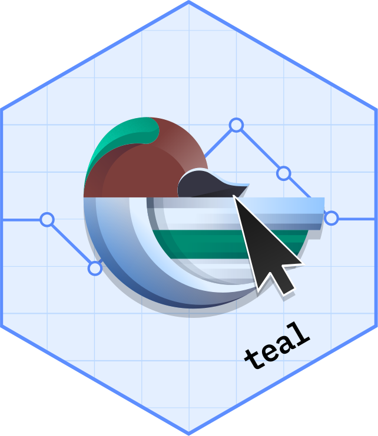
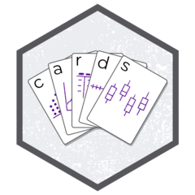

::::: {.hero}
:::: {.wrap}
::: {.eyebrow}
Open-source clinical reporting
:::

# Better tools. [Clearer insights.]{.accent}

Turn clinical data into meaningful results. Discover R packages built for analysis, reporting, and exploration.

[Explore the tools →](products.qmd){.btn-nest}

::: {.tagline}
Built in the open. Shaped by the community.
:::
::::
:::::

::::: {.band}
:::: {.wrap}
::: {.band-head}
::: {}
::: {.eyebrow}
Keep up with the ecosystem
:::
## Latest from NEST
:::

[All news →](news.qmd)
:::

::: {#latest-news}
:::
::::
:::::

::::: {.products-band}
:::: {.wrap}
::: {.band-head}
::: {}
::: {.eyebrow}
Small tools. Shared possibilities.
:::
## Find your starting point
:::

[See all products →](products.qmd)
:::

::: {.cards}
::: {.card-tool}
::: {.head}

::: {}
::: {.name}
teal
:::
::: {.kind}
Interactive exploration
:::
:::
:::

::: {.desc}
Bring your data into interactive applications for exploration and review.
:::

[Explore teal](https://insightsengineering.github.io/teal/){.go}
:::

::: {.card-tool}
::: {.head}

::: {}
::: {.name}
cards
:::
::: {.kind}
Analysis results
:::
:::
:::

::: {.desc}
A foundation for working with structured analysis results in R.
:::

[Explore cards](https://insightsengineering.github.io/cards/){.go}
:::

::: {.card-tool}
::: {.head}

::: {}
::: {.name}
cardx
:::
::: {.kind}
Extended analysis
:::
:::
:::

::: {.desc}
Extend your analysis workflows with additional tools for results.
:::

[Explore cardx](https://insightsengineering.github.io/cardx/){.go}
:::
:::
::::
:::::
